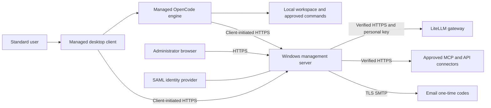

# Managed OpenCode

Central administration for an OpenCode coding assistant that runs on the user's computer. A Windows management server controls approved models, AI actions and connectors; the endpoint client edits files and runs approved commands locally.

**Development status:** Windows 0.1.4 is an unsigned pilot candidate with bounded lab evidence. Engine tests passed on the recorded macOS 15, 26 and 27 hosts. The Mac desktop GUI and PKG are unfinished, macOS 14 is untested, and **there is no final installer release yet**. Do not treat a passing engine workflow as approval for organization-wide deployment.

[Configure your deployment](managed-harness-platform/docs/CONFIGURATION.md) · [Problem and solution](managed-harness-platform/docs/PROBLEM-AND-SOLUTION.md) · [Test results](RESULTS.md) · [Release requirements](managed-harness-platform/cloud/RELEASING.md)

**Windows pilot download:** [v0.1.4-pilot.1](https://github.com/r0kud0mukur0/managed-opencode/releases/tag/v0.1.4-pilot.1) provides the preserved, tested Windows 0.1.4 EXE/MSIs, documentation, source and checksums. It is an unsigned prerelease with the limitations described above; no Mac installer is included.

## Why this project exists

An AI gateway such as LiteLLM can control model access and record prompts and responses. It cannot, by itself, decide whether a coding assistant may run PowerShell on a laptop, load a local plugin, change its provider configuration or call a new MCP connector.

An ordinary OpenCode configuration or launcher also does not establish an administrative boundary: users and projects can influence configuration, and an unrestricted engine can expose alternate paths around the intended settings. This project moves those decisions into a central service and a managed engine fork, with an administrator-owned installation and enrollment.

It also replaces a previous localhost HTTP relay workaround with verified HTTPS connections. The original certificate failure was not captured well enough to establish its exact cause; the implementation and synthetic TLS tests are documented separately from that historical diagnosis.

## How it works



Users sign in through SAML or an administrator-created email account with a one-time code. Each user enters their own LiteLLM key once; the server encrypts it and binds it to that user and gateway. The endpoint engine receives a limited management token instead of the gateway key. There is one shared administrative policy.

Endpoint connections are outbound to the configured server address and port. The product does not require a server-initiated inbound endpoint connection. Local engine and desktop authentication callbacks use loopback. Workspaces and conversation history stay on the endpoint; they are not roaming server profiles. Relevant file content can still be sent to the model when the assistant uses it.

## What administrators control

| Control | Behavior |
| --- | --- |
| AI gateway | Configure an approved HTTPS LiteLLM base URL centrally. |
| Models | Only enabled, explicitly approved model IDs are accepted. Cloud models also require the global cloud switch. |
| Local AI actions | Set Read, Edit, CMD and PowerShell to Allow, Ask or Deny, with execution limits. Current development source adds a separate macOS shell policy, default Deny. |
| Connectors | Add HTTPS MCP or custom API connectors, discover/import and review tools, select authentication, and enable or disable them centrally. |
| Identity and keys | SAML identity or approved email OTP accounts; per-user gateway keys and connector credentials. |
| Access changes | Disable accounts and revise policy. Managed work stops on detected revocation or connection failure, subject to polling and request timeouts. |
| Audit | Record sign-ins, administrative changes and security outcomes without duplicating LiteLLM prompt/response logging. |

The AI cannot approve its own new connector or replace protected installation settings. Arbitrary local `stdio` MCP processes, user plugins and user-selected provider configurations do not become approved through the managed client.

These controls apply to this application. Users retain their normal terminal access. An allowed AI shell has the ordinary user's permissions; the harness is not an operating-system sandbox. Local administrators and a compromised OS are outside the tamper-resistance boundary. Organizations must protect installation files and apply their own application allowlisting. Read the [security boundary](managed-harness-platform/docs/SECURITY.md) before deployment.

## Configure a pilot

1. Read the [support matrix](SUPPORT.md) and [verification ledger](managed-harness-platform/VERIFICATION.md). Build a candidate using the [build guide](managed-harness-platform/docs/BUILDING.md); final downloadable installers will appear in [Releases](https://github.com/r0kud0mukur0/managed-opencode/releases) only after acceptance.
2. Prepare a Windows server, DNS name, available HTTPS port, full certificate chain, LiteLLM URL and either TLS SMTP or SAML. Windows Server 2019 and 2022 are deployment targets with recorded pilot evidence.
3. Install the Server role using the graphical EXE, or deploy the Server MSI with a protected JSON configuration. Server Core requires silent installation and browser administration from another machine.
4. Sign into the web console. Approve destinations and model IDs, set AI action policy, create users and configure connectors. Models start empty and cloud access starts disabled.
5. Install the Client role on Windows 11 25H2 with the management server's HTTPS address, including its custom port. Users then sign in, save their personal key and select a workspace.
6. Run the [deployment acceptance checks](managed-harness-platform/docs/CONFIGURATION.md#9-accept-the-deployment) under standard user accounts before broader rollout.

The [configuration walkthrough](managed-harness-platform/docs/CONFIGURATION.md) provides the exact sequence, GUI labels, configuration files and troubleshooting. [Deployment templates](managed-harness-platform/deployment) contain example values only. Do not commit the populated copies.

## Documentation

| Guide | Contents |
| --- | --- |
| [Problem and solution](managed-harness-platform/docs/PROBLEM-AND-SOLUTION.md) | Gateway versus endpoint responsibilities, configuration bypass, TLS changes and tradeoffs. |
| [Configuration walkthrough](managed-harness-platform/docs/CONFIGURATION.md) | First server, identity, models, connectors, users, client enrollment and acceptance. |
| [Installation](managed-harness-platform/docs/INSTALLATION.md) | EXE/MSI commands, configurable ports, upgrades, repair and removal. |
| [Administration](managed-harness-platform/docs/ADMINISTRATION.md) | Everyday policy, model, user, connector and audit operations. |
| [Operations](managed-harness-platform/docs/OPERATIONS.md) | Service configuration, logs, backups and recovery limitations. |
| [Security](managed-harness-platform/docs/SECURITY.md) | Trust boundaries, credentials, transport and residual risks. |
| [Building](managed-harness-platform/docs/BUILDING.md) | Pinned build tools, source layout and packaging. |
| [Windows evidence](managed-harness-platform/VERIFICATION.md) / [Mac evidence](RESULTS.md) | What was actually tested and what remains. |
| [Release requirements](managed-harness-platform/cloud/RELEASING.md) | Exact-installer tests, independent review, provenance and release assets. |

## Source and contributions

Clone this repository, then follow the build guide for prerequisites and pinned tool versions:

```powershell
git clone https://github.com/r0kud0mukur0/managed-opencode.git
cd managed-opencode/managed-harness-platform
bun install --frozen-lockfile
bun run check
bun test test
```

Those commands check the management platform; they do not build an installer or establish full-client acceptance. Engine tests run from the relevant package directory in `managed-opencode-fork`, following its `AGENTS.md`. The manual [hosted workflow guide](managed-harness-platform/cloud/README.md) describes the Mac engine checks.

- `managed-harness-platform/`: management service, native Windows GUIs, packaging, tests and guides.
- `managed-opencode-fork/`: upstream OpenCode source with the managed engine changes.
- `UPSTREAM-REVISION.txt`: upstream base revision.
- `SOURCE-MANIFEST.json`: hashes for the published source snapshot; not a signature or installer attestation.

Contributions should include a clear problem statement, appropriate tests and documentation. Changes to authentication, grants, policy, transport or installation protection need independent review and tests that exercise the actual boundary. Do not include real keys, deployed configuration, user data or private infrastructure details in issues, pull requests or test evidence. Keep synthetic credentials visibly confined to test fixtures.

This is an independent project, not an official OpenCode distribution. The management platform is [MIT licensed](LICENSE). The engine fork and dependencies retain their own licenses and notices; see [third-party notices](managed-harness-platform/THIRD-PARTY-NOTICES.md). Repository visibility does not change those obligations.
