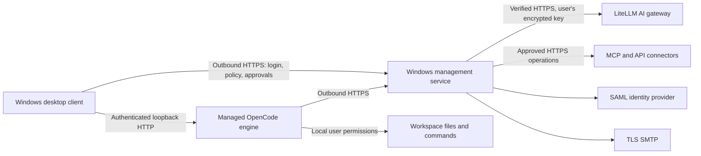

# Managed OpenCode

A self-hosted Windows management service and desktop client for centrally governed OpenCode. Files and commands run on the user's endpoint. Identity, approved models, connectors, credentials and policy live on the management server.

**Release 0.1.4: unsigned organizational pilot candidate, not an approved production release.** Read [VERIFICATION.md](VERIFICATION.md) for the tested boundaries and remaining acceptance gates. Windows Server 2019, Windows Server 2022 and Windows 11 25H2 have real-machine evidence within the scopes in the verification ledger. Current binaries are unsigned development artifacts.

Mac client development targets **macOS 14, 15, 26 and 27**. The server remains on Windows. See the [Mac support requirements](cloud/SUPPORT.md) and [hosted engine results](cloud/RESULTS.md); the Mac GUI and PKG are unfinished, and engine tests do not establish installer or full-client compatibility.

Download the preserved Windows EXE/MSIs, complete deployment package, source and checksums from the [v0.1.4-pilot.1 Windows pilot prerelease](https://github.com/r0kud0mukur0/managed-opencode/releases/tag/v0.1.4-pilot.1). The installed version remains 0.1.4; the prerelease is not final production or Mac-client acceptance.

## What administrators control

- One shared model catalog and LiteLLM HTTPS gateway. Cloud models are disabled by default and must also be individually approved.
- AI read, edit, CMD and PowerShell actions: allow, ask the user, or deny; command duration and session-step limits.
- Remote HTTPS MCP and custom HTTP API connectors, approved actions, argument schemas and resource restrictions. Shared service credentials, personal API keys and personal OAuth accounts are supported according to connector configuration.
- SAML identity or administrator-created local email accounts using SMTP one-time codes. Disabled users lose access.
- Server audit records for login, policy, configuration, credentials and security decisions.

The client requires a live server connection. It has no offline policy fallback. Users can choose approved models, select a workspace, sign in and enter their own key. They cannot add an arbitrary provider or connector through the managed engine's configuration.

## Deployment

Use `ManagedOpenCode-Setup.exe` for a graphical Server/Client installation, or the separate Client and Server MSI packages for enterprise deployment. Supply the client with the server's HTTPS DNS name or IP address **including the selected port**. A valid certificate must cover that address.

- [Step-by-step configuration](docs/CONFIGURATION.md)
- [Problem and solution](docs/PROBLEM-AND-SOLUTION.md)
- [Installation and deployment](docs/INSTALLATION.md)
- [Administration and user workflow](docs/ADMINISTRATION.md)
- [Security boundary and logging](docs/SECURITY.md)
- [Operations and recovery](docs/OPERATIONS.md)

The server service is `ManagedOpenCodeServer`. The application does not install a per-user scheduled worker task. Tasks named `ManagedCentral-OneTime…` in the lab are temporary test drivers, not product components.

## Architecture

The management server never opens a control connection to the endpoint. Browser SAML sign-in temporarily uses a loopback callback on the user's own machine. No inbound endpoint firewall exception is required for product operation.

## Source layout

`src/server` contains the management service and web console; `native` contains the WinForms client, installer and Windows service host; `packaging` contains MSI configuration and machine ACL enforcement. The managed OpenCode source currently resides in the adjacent `managed-opencode-fork` repository. `lab` contains environment-specific integration drivers and must not be deployed as product code.

The management source is MIT licensed. The OpenCode fork and bundled dependencies retain their own licenses. The prepared Windows 0.1.4 companion source archive contains the platform, modified fork, and pinned Bun/WiX source. The development Git repository and cloud-validation source ZIP contain the platform/fork and guides, but exclude the full release dependency archives and installers. Those materials must accompany the final installer release. A clean independent source rebuild and a complete software-composition/license audit remain outstanding. See docs/BUILDING.md and THIRD-PARTY-NOTICES.md.
